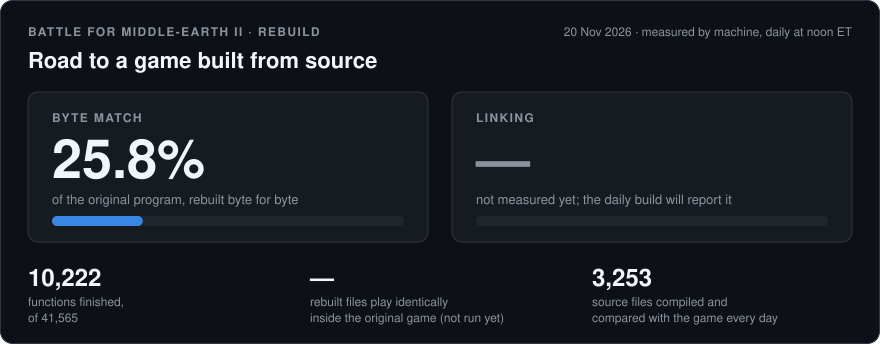
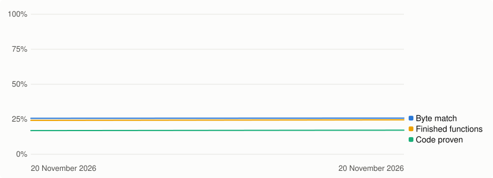

# Progress

Measured on main commit `64fce00c1ee6` (2026-11-20T18:29:53Z). This page is written by a workflow from the measurements alone; nobody edits it.

**Code matched**: `█████░░░░░░░░░░░░░░░` 25.7% (1,627,150 of 6,333,616 bytes)  
Share of the original program's code, by bytes, that our source compiles back to exactly.

**Code proven**: `███░░░░░░░░░░░░░░░░░` 16.9% (1,071,032 of 6,333,616 bytes)  
Share of the code, by bytes, whose match the checker could also prove (relocations and data references agree).

**Linking**: `░░░░░░░░░░░░░░░░░░░░` not measured yet  
Share of the names a full link of the game needs that our source already provides.

**Finished functions**: `█████░░░░░░░░░░░░░░░` 24.2% (10,054 of 41,565 functions)  
Functions that are matched, proven, live in a properly named file, and whose class is declared in a real header.

## Does the rebuilt game run?

Nightly build of main commit `43c8eae0c787` (2026-11-20).

- Starts: not run yet
- Reaches the main menu: not run yet
- Plays a skirmish: not run yet
- Equals the original game: not run yet
- Saves and loads: not run yet

## By part of the game

Code matched, by bytes, in each part of the source tree.

| Part | Matched | |
| --- | ---: | --- |
| GameEngine / Common | 33.3% (102,914 of 308,675 bytes) | `███████░░░░░░░░░░░░░` |
| GameEngine / GameClient | 19.4% (162,108 of 837,736 bytes) | `████░░░░░░░░░░░░░░░░` |
| GameEngine / GameLogic | 26.0% (386,043 of 1,483,402 bytes) | `█████░░░░░░░░░░░░░░░` |
| GameEngine / GameNetwork | 42.5% (91,322 of 214,687 bytes) | `█████████░░░░░░░░░░░` |
| GameEngineDevice / MilesAudioDevice | 0.3% (189 of 64,798 bytes) | `░░░░░░░░░░░░░░░░░░░░` |
| GameEngineDevice / W3DDevice | 8.0% (41,945 of 522,891 bytes) | `██░░░░░░░░░░░░░░░░░░` |
| GameEngineDevice / Win32Device | 57.0% (1,564 of 2,742 bytes) | `███████████░░░░░░░░░` |
| Libraries | 50.1% (544,067 of 1,085,466 bytes) | `██████████░░░░░░░░░░` |
| Tools | 100.0% (744 of 744 bytes) | `████████████████████` |
| Unplaced | 0.0% (0 of 104,533 bytes) | `░░░░░░░░░░░░░░░░░░░░` |
| fesl | 0.0% (0 of 42,125 bytes) | `░░░░░░░░░░░░░░░░░░░░` |
| gamespy-sdk | 98.4% (105,280 of 106,969 bytes) | `████████████████████` |
| lua-4.0.1 | 96.7% (61,462 of 63,532 bytes) | `███████████████████░` |
| lzhl-1.0 | 99.7% (7,125 of 7,150 bytes) | `████████████████████` |
| nbench | 0.0% (0 of 26,290 bytes) | `░░░░░░░░░░░░░░░░░░░░` |
| ppmalloc-1.26.11 | 0.0% (0 of 14,445 bytes) | `░░░░░░░░░░░░░░░░░░░░` |
| stlport-4.6 | 88.2% (28,615 of 32,452 bytes) | `██████████████████░░` |
| unk | 5.0% (70,053 of 1,391,260 bytes) | `█░░░░░░░░░░░░░░░░░░░` |
| zlib-1.1.4 | 100.0% (23,719 of 23,719 bytes) | `████████████████████` |

Provisional (Draft) headers still included by source: 27.

## Over time

| Main commit | Date (UTC) | Matched | Proven | Linking | Finished |
| --- | --- | ---: | ---: | ---: | ---: |
| `64fce00c1ee6` | 2026-11-20T18:29:53Z | 25.69% | 16.91% | — | 24.19% |

How each figure is computed: [ci/progress/README.md](https://github.com/Open-BFME/BFME2-Rebuild/blob/main/ci/progress/README.md).
